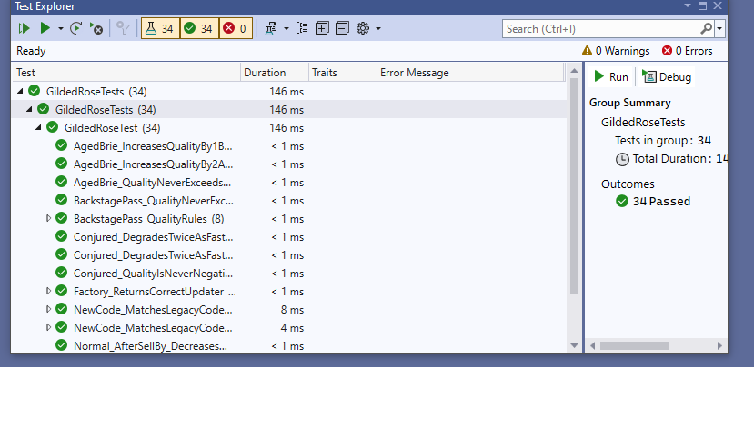

# BÁO CÁO BÀI THỰC HÀNH 03 – REFACTORING (GILDED ROSE)

- **Môn học:** Thiết kế, phát triển và bảo trì phần mềm
- **Họ và tên:** Ngo Truong Giang
- **MSSV / Lớp:** DPM235413
- **Công cụ:** Visual Studio 2022, .NET 8, C#, xUnit, Git

---

## 1. Giới thiệu bài toán

Cửa hàng Gilded Rose bán nhiều loại hàng. Mỗi ngày hệ thống cập nhật hai giá trị của mỗi item:
`SellIn` (số ngày còn lại để bán) và `Quality` (chất lượng). Luật cập nhật:

| Loại item | Luật mỗi ngày |
|---|---|
| Thường | SellIn giảm 1, Quality giảm 1. Quá hạn (SellIn < 0) Quality giảm 2 |
| Aged Brie | Quality **tăng** 1 (quá hạn tăng 2) |
| Sulfuras | Không đổi SellIn và Quality (Quality = 80) |
| Backstage pass | Tăng 1; còn ≤ 10 ngày tăng 2; còn ≤ 5 ngày tăng 3; sau buổi diễn về 0 |
| **Conjured** (mới) | Giảm nhanh gấp đôi item thường |

Ràng buộc chung: Quality không âm và không vượt quá 50 (trừ Sulfuras). Lớp `Item` không được sửa.

## 2. Vấn đề của code cũ

Hàm `UpdateQuality()` ban đầu chứa nhiều khối `if` lồng nhau, kiểm tra tên item lặp đi lặp lại:

- **Khó đọc:** khó biết một loại item cụ thể được xử lý ở đâu.
- **Khó bảo trì:** sửa luật một loại item dễ làm hỏng loại khác.
- **Khó mở rộng:** thêm loại mới (Conjured) buộc phải chèn thêm `if` vào hàm vốn đã rối.
- **Vi phạm nguyên tắc thiết kế:** một hàm làm quá nhiều việc (Single Responsibility), và phải sửa code cũ mỗi khi thêm tính năng (Open/Closed).
- **"Magic string":** tên item viết thẳng trong code ở nhiều chỗ.

## 3. Giải pháp refactor

Áp dụng **Strategy Pattern** kết hợp **Factory** và **Template Method**.

```
GildedRose.UpdateQuality()
        │  với mỗi item
        ▼
ItemUpdaterFactory.Create(item)  ──►  IItemUpdater
                                          ▲
                                   ItemUpdaterBase  (Template Method)
              ┌──────────────┬──────────┼───────────────┬──────────────────┐
     NormalItemUpdater  AgedBrieUpdater  SulfurasUpdater  BackstagePassUpdater  ConjuredItemUpdater
```

| Thành phần | Vai trò |
|---|---|
| `IItemUpdater` | Giao diện chung: `Update(Item)` |
| `ItemUpdaterBase` | Quy định trình tự một ngày: đổi Quality → giảm SellIn → xử lý quá hạn. Chứa hàm dùng chung `IncreaseQuality`, `DecreaseQuality` (có chặn 0 và 50) |
| 5 lớp updater | Mỗi lớp chỉ chứa luật của đúng một loại item |
| `ItemUpdaterFactory` | Chọn updater theo tên item |
| `ItemNames` | Gom các tên item vào hằng số, loại bỏ magic string |
| `GildedRose` | Chỉ còn lặp qua danh sách và gọi updater tương ứng |

Hàm `UpdateQuality()` sau refactor:

```csharp
public void UpdateQuality()
{
    foreach (var item in _items)
        ItemUpdaterFactory.Create(item).Update(item);
}
```

## 4. Các nguyên tắc thiết kế được áp dụng

- **Single Responsibility:** mỗi lớp updater chỉ lo luật của một loại item.
- **Open/Closed:** thêm loại item mới chỉ cần thêm lớp mới và một dòng trong Factory, không sửa lớp cũ. Tính năng Conjured được thêm đúng theo cách này.
- **DRY:** logic chặn Quality trong khoảng 0–50 nằm ở một chỗ duy nhất (lớp cơ sở).
- **Liskov / Dependency Inversion:** `GildedRose` chỉ phụ thuộc giao diện `IItemUpdater`, không phụ thuộc lớp cụ thể.

## 5. Quy trình thực hiện (an toàn khi refactor)

1. Giữ lại code gốc thành `LegacyGildedRose.cs` làm chuẩn so sánh.
2. Viết **test đặc tả (characterization test)**: chạy cả code cũ và code mới với nhiều tổ hợp `SellIn` (-3 → 16) × `Quality` (0 → 50) × 4 loại item, trong 1 ngày và 60 ngày, rồi yêu cầu kết quả giống hệt nhau.
3. Refactor từng bước, chạy test sau mỗi bước.
4. Sau khi hành vi cũ được bảo toàn, mới thêm tính năng Conjured (viết test trước, cài đặt sau).
5. Commit bằng Git cho từng giai đoạn.

## 6. Kiểm thử

Bộ test xUnit (`GildedRoseTests/GildedRoseTest.cs`) gồm:

- Luật từng loại item: thường, Aged Brie, Sulfuras, Backstage pass (các mốc 15/11/10/6/5/1/0/-1 ngày), Conjured.
- Các biên: Quality không âm, Quality không quá 50.
- Kiểm tra Factory trả đúng loại updater.
- Test đặc tả so sánh code mới với code cũ (1 ngày và 60 ngày).

**Kết quả chạy test:**" 34/34 test đạt (34 Passed, 0 Failed)" 

## 7. Kết luận

Sau refactor, hành vi của hệ thống được giữ nguyên (được xác nhận bằng test đặc tả), trong khi code ngắn gọn, mỗi luật nằm đúng một chỗ, và việc thêm Conjured không cần sửa các lớp cũ. Thiết kế này giúp bảo trì và mở rộng dễ dàng hơn nhiều so với hàm `if` lồng nhau ban đầu.

## 8. Bài học rút ra

- Phải có test bảo vệ **trước khi** refactor.
- Refactor là đổi cấu trúc mà không đổi hành vi; thêm tính năng là bước riêng, làm sau.
- Strategy Pattern giúp thay chuỗi `if/else` theo kiểu dữ liệu bằng đa hình.
